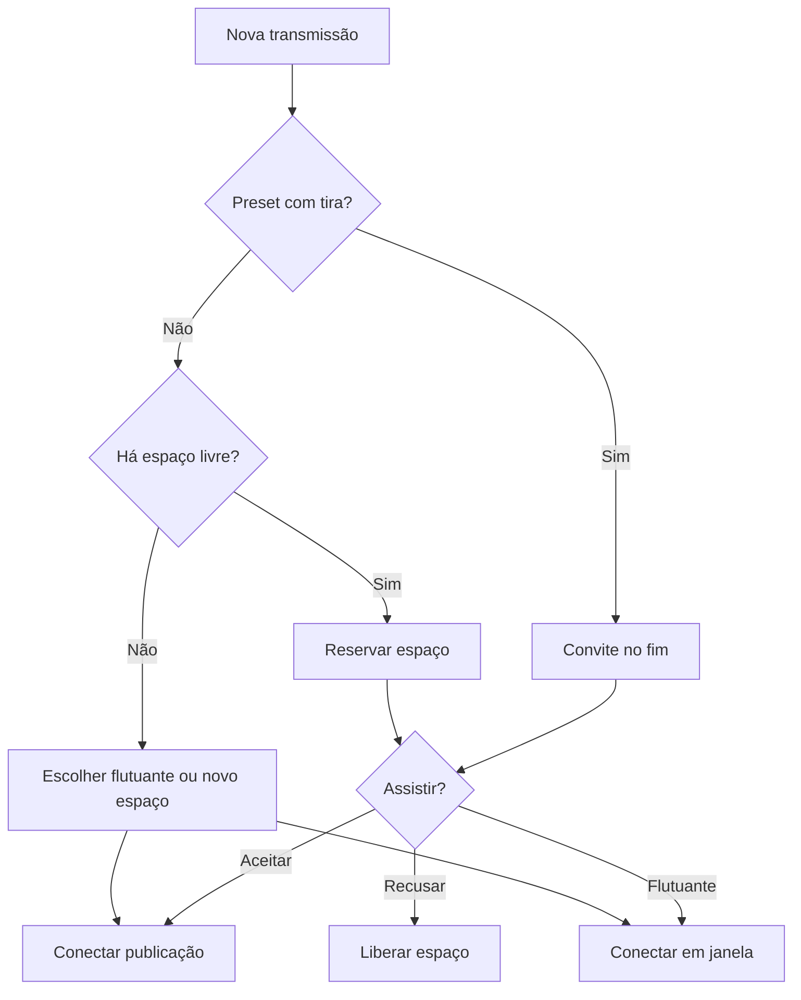
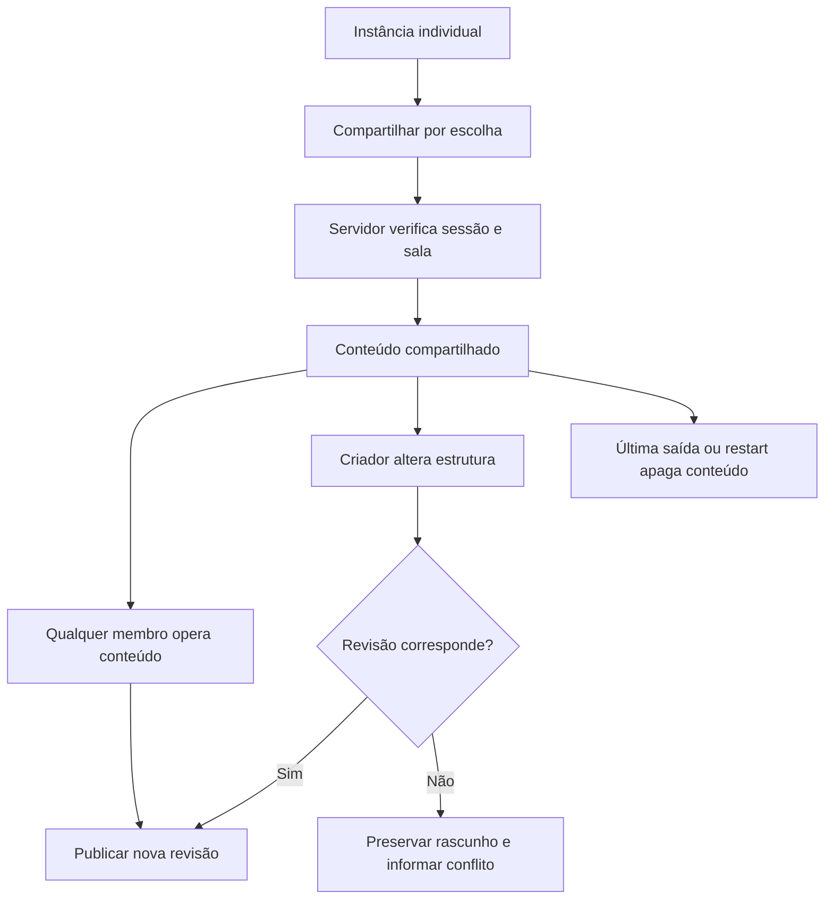

# Canvas e widgets — 2.7.0-rc.1

Estado em 05/10/2026: implementação em revisão no ramo `feat/canvas-widgets`.
Não confundir testes automatizados com aceite visual ou de mídia em aparelhos.
O relatório de pesquisa precedeu esta implementação; o usuário aprovou as decisões
recomendadas e os detalhes abaixo em 05/10/2026.

## Decisões confirmadas

A tira é linear, sem voltar do último item ao primeiro, e avança um item por ação.
Mostra três itens no desktop, dois abaixo de 680 px e um abaixo de 380 px. Em telas
estreitas a tira fica embaixo do foco, independentemente do lado escolhido no desktop.
Os quatro presets com um espaço grande passam a 2 × 2 no celular para conservar
áreas utilizáveis. Essa adaptação foi uma decisão recomendada de implementação.

A tela grande integra o grid. Arrastar para seu espaço ou usar Focar troca as
posições, sem desconectar streams. Foco único é uma ação separada: só um widget
fica visível, mas os players de áudio e as assinaturas das outras telas continuam.
Botões de fullscreen individuais foram retirados conforme a correção do usuário;
o comando global da sala e o PiP permanecem.

Uma nova transmissão reserva um espaço vazio e pergunta antes de conectar. Recusar
remove a reserva e restaura o espaço vazio. Se o grid estiver cheio, a pessoa escolhe
entre criar um espaço ou assistir flutuante. O grid nunca cresce apenas porque alguém
começou a transmitir. Na tira, o convite entra depois do último item ocupado, sem
mudar a rolagem. A aba Pessoas e o catálogo permitem reconsiderar uma transmissão.
Se um preset for reduzido, os excedentes ficam escondidos com áudio ativo; o usuário
escolhe um novo espaço ou Flutuante ao restaurar. Reduzir o preset não cria sobreposições.

Widgets são individuais por padrão. Compartilhar é uma ação explícita com aviso
sobre alcance e duração dos dados. Todos podem usar placares, notas e cronômetros
compartilhados; somente o criador altera a estrutura ou exclui para a sala. A geometria
nunca é compartilhada. Se o criador sair, o conteúdo continua operável, com estrutura
bloqueada; é possível criar uma cópia individual. Essa foi uma decisão recomendada.
Não há transferência automática de autoria nem autoridade de dono da sala nesta etapa.

## Implementação

React 19.3, TypeScript 5.9.3, CSS próprio e `@dnd-kit/react` 0.5.0 (MIT, fixada no lock).
A dependência foi aprovada com a recomendação híbrida: dnd-kit para sensores/colisões
acessíveis; CSS Grid para os slots; Pointer Events para resize e gesto da tira.
Nenhum sistema de renderização ou servidor de mídia foi substituído.

| Módulo | Responsabilidade |
|---|---|
| `canvas/model.ts` | Estado, presets, trocas, reservas, janelas e persistência |
| `canvas/geometry.ts` | Retângulos, limites e IntersectionObserver dos espaços |
| `canvas/drag.ts` | Destino sob o ponteiro e próximo espaço por direção do teclado |
| `canvas/RoomCanvas.tsx` | Admissão de transmissões e coordenação dos controles |
| `canvas/WidgetFrame.tsx` | Host estável, alça, teclado, resize e animação FLIP |
| `canvas/widgets.tsx` | Registro dos widgets nativos e adaptação aos espaços |
| `canvas/CustomWidget.tsx` | Blocos, rascunhos e compartilhamento opcional |
| `shared/widgets.ts` | Contrato validado, operações e semântica de cronômetros |
| `server/widgets.ts` | Estado compartilhado, autoria, revisões, deduplicação e cotas |
| `media/peers.ts` | Demanda de vídeo por assinatura, preservando áudio |

`CanvasState` tem `schemaVersion: 1`, preset, proporção, espaços com IDs estáveis,
instâncias de widgets, posições proporcionais das janelas, widgets escondidos,
convites e estado de foco. A persistência usa `vio:canvas:v1`, valida a versão e
restaura uma configuração segura quando o dado está corrompido. Conteúdo individual
fica no navegador; referências a transmissões e widgets de uma sala não são restauradas
em outra. Reservas e diálogos não são gravados.

O motor não conhece telas, participantes, áudio ou blocos personalizados. Ele manipula
IDs, ocupação e geometria. O registro externo declara `id`, título, descrição, tamanho
mínimo/preferido, `canFloat`, `apiVersion` e renderer. Container queries adaptam cada
widget. O renderer recebe visibilidade, tamanho e foco. Atualizações visuais de widgets
ocultos, timers e analisadores de voz são suspensas; manutenção de WebRTC e sinalização
necessária à sala continua independente da visibilidade.

## Continuidade da mídia

Hosts de vídeo são irmãos em um único contêiner, indexados por `publicationId`,
independentemente de grid, tira ou janela. Slots são alvos geométricos; trocar a posição
altera transform/tamanho, não o pai do vídeo. O feedback de arraste do dnd-kit não clona
nem move elementos de mídia. Áudio fica em uma coleção separada com as mesmas chaves,
fora de qualquer conteúdo escondido ou recortado.

Com `feedback="none"`, a integração fornece explicitamente a geometria da operação
ao dnd-kit 0.5.0. O movimento usa as coordenadas do evento e o encaixe final usa o
ponto de soltura, inclusive quando um widget grande vai para um espaço pequeno.
Soltar fora dos espaços conserva a posição no grid; isso não cria uma janela por
acidente. Espaço inicia/conclui o arraste por teclado, setas escolhem um espaço
visível na direção indicada e o menu Organizar oferece a mesma operação por botões.
Referências oficiais consultadas em 05/10/2026:
[DragDropProvider](https://dndkit.com/react/components/drag-drop-provider/) e
[detecção de colisões](https://dndkit.com/react/guides/collision-detection/).

O comando `demand` aceita somente vídeo de assinatura `main` de tela e somente do seu
espectador autenticado. `off` desativa o encoding daquele sender; `replaceTrack(null)`
é fallback do vídeo se a API não aceitar a pausa. Retomar reconecta a mesma faixa ao
mesmo sender. A captura do publicador, outros espectadores e senders de áudio permanecem.
Pedidos antecipados são guardados até criar o peer. A prévia continua separada e barata,
sem promoção a `main`.

A qualidade solicitada acompanha altura do slot e DPR limitado a 1,5, com 220 ms de
estabilização. Espaços pequenos pedem até 12 FPS / 450 kbps; nunca superam a qualidade
escolhida pelo publicador. Isto adapta encodings individuais em uma malha P2P; **não é
seleção de camada de um SFU/simulcast**. Efetividade e retomada precisam de medição em
cada navegador. A API pode limitar parâmetros; o diagnóstico mostra dados efetivos.

O olho conta espectadores com assinatura principal conectada, incluindo quem apenas
mantém o áudio em segundo plano. Não mede atenção. Miniaturas e a própria prévia não
contam. Perda RTP é uma proporção acumulada de pacotes recebidos/perdidos quando o
navegador fornece essa estatística; dados indisponíveis não são inventados.

## Colaboração e segurança

Zod rejeita campos extras, IDs inválidos, blocos duplicados, textos acima de 2.000
caracteres e estruturas acima de seis blocos. Há até seis widgets compartilhados por
criador e 32 por sala, para limitar memória e tráfego; isso não limita participantes.
Operações são limitadas por sessão/minuto. Identidade e sala vêm da sessão autenticada,
nunca de um campo `owner` enviado pelo cliente.

Incrementos de placar são operações atômicas com ID para deduplicação. Texto, timer e
estrutura usam revisão para rejeitar atualizações antigas. Rascunhos de texto permanecem
na interface em caso de conflito. Cronômetros usam tempo do servidor, não ticks enviados
pela rede. Todo texto é renderizado como texto pelo React, sem HTML arbitrário.

Notas individuais são salvas localmente enquanto a pessoa digita; compartilhar
imediatamente inclui esse conteúdo. Nas notas compartilhadas, o rascunho permanece
local até Salvar, com revisão para detectar conflito. O campo fica temporariamente
indisponível durante esse envio, evitando sobrescrever uma edição ainda em andamento.

O conteúdo é descartado imediatamente quando o último membro sai ou quando todos
expiram após a tolerância de reconexão. O TTL residual do código da sala não conserva
widgets. Reiniciar o servidor também apaga o estado, pois não há banco de dados.

## Plataforma futura

O atual contrato é um registro de renderers internos, não um SDK para executar plugins.
A aba Comunidade é honesta e vazia. Não há `eval`, import de código remoto ou permissão
implícita para um widget acessar credenciais do VIO.

O futuro adaptador deverá declarar manifesto versionado (`apiVersion`, ID, autor,
origem, versão, ícone, tamanho e permissões) e um ciclo de vida de montar, redimensionar,
mostrar/ocultar e desmontar. O motor receberá a mesma instância genérica; o renderer
externo encaminhará tamanho, tema e visibilidade via RPC validado. O autor controla sua
interface e pode optar por receber tokens do tema. Não impor tipos específicos de apps
ou serviços ao motor.

Código de terceiros deverá ficar em origem isolada, sandbox de iframe e canal com
origem/source/nonce verificados, sem referência a tokens, DOM ou storage do app. Acesso
a dados da sala deverá ser mínimo, explícito e revogável. CSP e lista de domínios são
camadas de contenção; iframe/CSP sozinhos não constituem firewall completo nem impõem
cotas rígidas de CPU/memória. Limites fortes exigem avaliação do runtime nativo ou de
um intermediário de rede, mecanismos de encerramento e um modelo de distribuição.
Esses controles não estão implementados e não são anunciados como disponíveis.

Contas, verificação de autores, denúncias, remoção de plugins, instalável e dono da sala
ficam para etapas futuras. Consulte `arquivo/PENDENCIAS.md` para requisitos em linguagem simples.

## Aceite

A Parte A precedeu o canvas. Depois foram integrados o modelo, os hosts estáveis e as
permissões dos widgets, com testes de servidor e invariantes. `VALIDACAO.md` contém o
resultado atual e os testes manuais ainda necessários. Nenhuma versão é promovida a
produção com base apenas em testes de estado.
