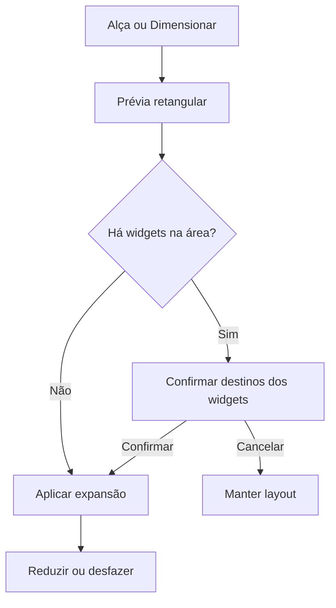

# VIO — rodada C: ajustes e decisões abertas

Base inspecionada: `257f679`, ramo `feat/canvas-widgets`, VIO_TEST. Data: 06/10/2026.
Prévia candidata: **2.7.0-rc.2**. Produção não é o alvo desta rodada.
O anexo Texto colado(1).txt substitui os requisitos anteriores onde houver conflito.

## Triagem e entregas

| Itens | Tratamento nesta rodada |
|---|---|
| C1–C8 | Correções de foco redundante, X sem ação, menu repetido, ajuda recortada, fullscreen, setas, catálogo vazio e compartilhamento sem duplicação. |
| C9 | Recuperação automática após diagnóstico e pesquisa; testes reais de sinalização local. |
| C10 | Foco único resolve primeiro o espaço grande, evitando `focusId` antigo. |
| C11–C12 | Um widget Pessoas, com presença, estado de chamada/tela, volume só na chamada e Assistir direto para telas ainda não aceitas. Minha cor tem painel próprio, sem duplicar a lista de pessoas. |
| C13–C16 | Arraste livre + Shift, encaixe por teclado e por Layout → Mover widget; botão cria/destaca espaço vazio; tempo no detalhe do ping; modos e detalhes com seleção visual. |
| C17–C18 | Inatividade do mouse de 1 segundo; no toque, 4 segundos para permitir a sequência de toques. Foco visível, edição e painéis abertos preservam controles. Barra superior de fullscreen aparece no topo ou pelo foco de teclado. |
| C19 | Olho por publicação; servidor fornece apenas assinantes explícitos `main` da mesma sala. Miniaturas não contam. Inclui quem ainda conecta ou mantém áudio em segundo plano; não é prova de que a pessoa está olhando fisicamente para a tela. |
| C20 | Removido Esconder. Foco único preserva players e assinaturas, suspendendo demanda de vídeo fora do foco. Reduzir preset mantém os espaços necessários para os widgets abertos. |
| C21–C23 | Ícones próprios; fechar como criador encerra para todos, fechar como participante só remove localmente; Cronômetro separado, progressivo/regressivo e repetição. |
| C24 | Proposta abaixo, sem implementar chat ou novo fluxo de notas antes da decisão. |
| C25 | Novos personalizados oferecem contadores de pontos. Editor não oferece novos blocos de texto/timer. Conteúdo misto legado é preservado até sua migração, para não apagar dados. Novos blocos aguardam decisão. |
| C26 | Proposta e diagnóstico abaixo; span/mesclagem ainda não implementados. |
| C27 | Grades internas, notas, mixer, conexão, pessoas e controles adaptam-se ao espaço; scroll continua disponível quando necessário. Validação com spans dependerá de C26. |

## Diagnósticos antes das mudanças

### C9 — reconexão

Havia três caminhos que encerravam a recuperação: Socket.IO limitado a oito tentativas;
`rejoin()` em erro mudava para `failed` sem agendar nova entrada; WebRTC desistia após
quatro tentativas ICE. A reconexão do transporte sozinha não garantia a reentrada na sala.

Estratégia: Socket.IO 4.8.x continua reconectando com espera progressiva e variação aleatória,
até cerca de 30 segundos entre tentativas. Reentrada tem agenda própria, uma por vez,
e tratamento de erros temporários. Limites de taxa continuam no servidor; quando
informados pelo protocolo, recebem espera de 60 segundos. Erros permanentes de autorização
não entram em repetição. Sessão expirada requer nova credencial emitida pelo servidor;
essa situação pode trocar a identidade técnica, mas não solicita nova captura de tela.
Não se reaproveita credencial expirada ou se contornam limites por IP.

ICE restart usa a negociação existente (`createOffer({iceRestart:true})`), apenas para
peers com falha, inicialmente em 2/4/8/16 segundos e depois tentativas mais espaçadas.
Não cria outra captura nem desliga o sender de áudio para recuperar vídeo.
Eventos online/offline/visibilidade são pistas; `navigator.onLine` não bloqueia o app.
Saída, mudança de geração e destruição limpam as tentativas; respostas antigas são descartadas.

Fontes oficiais consultadas em 06/10/2026:
- [Socket.IO 4.x — opções do cliente](https://socket.io/docs/v4/client-options/): tentativas, atraso exponencial e aleatoriedade.
- [Socket.IO — ciclo de conexão](https://socket.io/docs/v4/client-socket-instance/): quedas de transporte e desconexão explícita têm comportamento diferente.
- [MDN — ICE restart](https://developer.mozilla.org/en-US/docs/Web/API/RTCPeerConnection/restartIce): retomada pela negociação e preservação de mídia existente.
- [MDN — navigator.onLine](https://developer.mozilla.org/en-US/docs/Web/API/Navigator/onLine): indicador heurístico, não uma garantia de acesso ao servidor.

### C10 — foco único

O espaço grande era identificado por `slots[0].widgetId`, mas ativar Foco único usava
`focusId ||= ...`. Um id já preenchido podia apontar a um widget pequeno após restaurar
ou alterar o preset. Agora a resolução é compartilhada entre desenho, botão de foco e
entrada em Foco único. Presets assimétricos usam o ocupante do espaço principal.
Mover/focar não fecha assinaturas nem recria players. Testes cobrem foco antigo,
alteração de preset e volta ao conjunto.

### C26 — abrangência de células

O modelo atual é uma lista ordenada de slots, um ocupante por posição, mais coordenadas
normalizadas de flutuantes. O CSS define áreas dos presets, mas **o estado salvo não possui
row/column/rowSpan/colSpan**. Portanto não suporta a mesclagem arbitrária nativamente.
O CSS Grid comporta spans; a mudança necessária é no contrato e na ocupação, não na
biblioteca de arraste nem no WebRTC. Não foi feita migração silenciosa nesta rodada.

- [MDN — grid-column/span](https://developer.mozilla.org/en-US/docs/Web/CSS/grid-column).
- [WCAG 2.2 — alternativas ao arraste](https://www.w3.org/WAI/WCAG22/Understanding/dragging-movements.html): oferecer operação por clique/toque além do teclado.

## Propostas que precisam de decisão

### 1. Notas: caixas e envio explícito

Recomendação: manter **Notas**, com até seis caixas tituladas. Cada caixa tem copiar,
salvar e “Enviar cópia para a sala”. O envio cria uma nota recebida identificada pelo
remetente e horário, que cada participante pode adicionar ao próprio layout. “Compartilhar
para editar juntos” continua sendo uma opção separada, com versões e aviso de conflito.
Isso troca textos sem transformar Notas num histórico de conversa.

Alternativa: uma aba Conversa dentro de Notas, com mensagens e limites por tamanho/frequência,
sem persistência. É uma função nova e precisa de regras para mensagem, exclusão e reconexão.

Pergunta: prefere começar pelas caixas com envio de cópia (recomendado), ou pela aba Conversa?

Para dados compartilhados, recomendação de duração: memória da sala, apagada ao esvaziar/reiniciar.
Atualizar **um** navegador não apagaria as notas de **todos**. Conteúdo individual continua
local, como já funciona. Se for escolhida Conversa, confirmar a regra de histórico em refresh:
ver somente novas mensagens ao voltar é diferente de apagar o histórico da sala inteira.

### 2. Personalizado: blocos próprios

Recomendação inicial, além dos contadores de pontos:

| Bloco | Uso | Regras sugeridas |
|---|---|---|
| Lista de tarefas | Marcar objetivos da sessão | Criador define itens; participantes marcam/desmarcam quando compartilhado. |
| Votação simples | Escolher jogo, filme ou próxima atividade | Criador define opções; uma escolha por sessão, alterável; sem prometer identidade duradoura. |

Notas e tempo permanecem nos widgets dedicados. Composições antigas mistas seriam divididas
em widgets dedicados, preservando o texto e os valores, sem copiar conteúdo automaticamente
para outra sala. Só o criador faria essa conversão quando o widget fosse compartilhado.

Pergunta: aprova Lista de tarefas e Votação como primeiros blocos e essa migração sem perda?

### 3. Expansão e mesclagem

Recomendação: arrastar o **cabeçalho** continua movendo livremente; Shift no arraste ativa
encaixe. A **alça de borda/canto** é uma operação distinta: expande sobre células da grade,
mostrando uma prévia da área. Somente retângulos, sem sobreposições ou áreas em L.
No toque/teclado, Layout → Dimensionar oferece linhas/colunas e vizinhos por botão, sem
exigir precisão no arraste. Não adicionar gesto oculto de “soltar um widget sobre outro
para mesclar”: hoje esse gesto já significa trocar posições.

Se a área contiver outro widget, mostrar quais serão deslocados e pedir confirmação.
Eles vão para espaços livres/novos no próprio grid, preservando áudio/conexões, nunca
viram flutuantes por conta própria. Cancelar mantém tudo. Reduzir pela mesma alça libera
as células; Desfazer restaura a operação anterior, sem sobrescrever mudanças posteriores.

Modelo proposto v2: slots/células com coordenadas; placement por widget com
`row`, `column`, `rowSpan`, `colSpan`; transação validada de ocupação. Migrar v1 preservando
ids dos widgets e mídia. Alterar manualmente marca o arranjo como Personalizado.
Salvar preset local reutilizável armazena só geometria, sem nomes, textos, sessões ou mídias.

Na tira, manter itens de tamanho fixo; não mesclar nesta etapa. O tamanho do foco continua
pelo controle de proporção. Isso preserva o avanço linear e o alinhamento das miniaturas.

Pergunta: aprova alça exclusiva, confirmação ao ocupar vizinhos, preset local e mesclagem só no grid?

## Validação desta rodada

- 64 testes automatizados: regressão de foco/slots/identidade; temporizadores; segurança e
  espectadores por publicação; reentrada após erro; mais de oito tentativas; restart real
  de sinalização; cancelamento ao sair. O teste de recuperação usa o Controller real e
  Socket.IO real, com tempos de transporte reduzidos e uma resposta de join rejeitada.
- TypeScript estrito e build concluídos. Sem dependência nova.
- O navegador remoto bloqueou a bancada localhost (`ERR_BLOCKED_BY_CLIENT`).
  Essa limitação não prova falha do aplicativo. Validação visual será feita na prévia.
- Testes de sender são sintéticos. Medição de CPU/banda, escuta real, PC + celular,
  TURN entre redes e recuperação com capturas físicas precisam de ensaio desta versão.
- O usuário informou que a maioria das pendências anteriores foi aceita; isso é registrado
  como aceite informado, sem converter esse relato em medição desta nova revisão.

## Checklist do projeto

| Área | Situação |
|---|---|
| Tempo real | Testes de sinalização/estados ok; mídia física desta revisão pendente. |
| Som | Players preservados por arquitetura; sem novo efeito; volume e mute existentes mantidos. Escuta pendente. |
| Layout/design | Controles/presets responsivos e movimento reduzido implementados; conferir interface publicada. |
| Acessibilidade | Destinos por clique/toque, teclado e ARIA; leitor de tela/dispositivo físico pendente. |
| Segurança | Mesma autorização de sala; exclusão do criador, tipos e limites testados; sem código de terceiros. |
| Performance | Vídeo fora do foco tem demanda suspensa; medição física e carga de seis pessoas pendentes. |
| Escopo | Sem contas, banco, dono da sala ou infraestrutura nova. |
