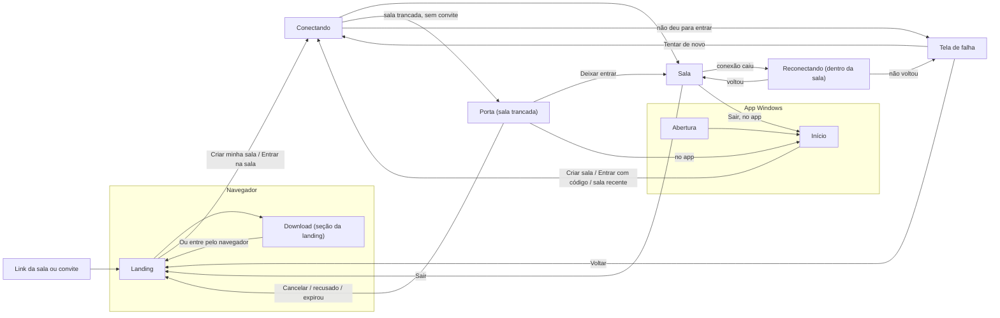

# Guia de telas

Fase 1d do [plano de design](plano.md) (#227). Diz **o que** cada tela do VIO tem, em que ordem de
importância, em que estados e como se chega e se sai dela. **Não diz como ela parece**: forma,
cor, tipo e movimento são da fase 2 em diante. Componentes (modal, folha, balão, toast, menu,
confirmação) aparecem só pelo nome da família; o desenho de cada um fica no
[guia de componentes](componentes.md) (fase 1c).

Base: o [inventário da fase 1b](inventario.md), as specs aprovadas em [`docs/design/`](../README.md),
o código em `src/client/` e `src-tauri/` e o [guia do Ponto](movimento-ponto.md). Onde este guia
pede algo que o produto ainda não tem, a linha leva **(sugestão)** e precisa do aval do usuário
antes de virar issue.

## 1. Fixo e variável

A fase 2 explora estilos sobre telas que já têm conteúdo, ordem e fluxo resolvidos. O que está na
coluna da esquerda vale para qualquer estilo; o da direita é o que cada estilo pode propor.

| Fixo em toda tela (nenhum estilo muda)                                                                | Livre para o estilo                                                      |
| ----------------------------------------------------------------------------------------------------- | ------------------------------------------------------------------------ |
| **Conteúdo**: o que existe em cada tela; nada entra nem sai por causa do estilo                       | Forma: raio, borda, sombra, textura, profundidade                        |
| **Hierarquia**: a ordem da lista "Conteúdo e hierarquia" de cada tela (1 = o que se vê primeiro)      | Como a ordem se mostra: tamanho, peso, cor, espaço, posição              |
| **Uma ação principal** por estado e por superfície (tela, modal, balão)                               | Como a ação principal se destaca                                         |
| **Fluxo**: de onde se chega, para onde se vai, o que cada saída faz                                   | Disposição na tela, desde que a ordem de leitura e de foco siga a ordem  |
| **Estados**: todos os listados existem e têm texto                                                    | Densidade e espaçamento, respeitando os alvos mínimos                    |
| **Textos** deste guia, até a revisão de textos                                                        | Caixa (alta ou baixa), espaçamento de letras, escala tipográfica e pesos |
| Tema escuro; azul `#2727F5` como cor da marca; a cor de cada pessoa é dela                            | Paleta de apoio, superfícies e acentos, com contraste AA                 |
| Fontes: Bricolage Grotesque (interface) e IBM Plex Mono (código da sala, tempo, ping, números)        | Ilustração, fundo, ícone decorativo                                      |
| Ícones da família `lucide-react`                                                                      | Traço do ícone entre 1,5 e 2 px; 16, 20 ou 24 px                         |
| Acessibilidade mínima ([seção 2.2](#22-acessibilidade))                                               | Desenho do anel de foco, desde que tenha contraste de 3:1                |
| O Ponto: as cinco regras e onde ele descansa ([movimento-ponto.md](movimento-ponto.md), seções 1 e 5) | Como o Ponto se mexe, dentro das regras (a fase 2 explora, a 5 produz)   |
| Mídia intocada: foco, layout e transição nunca recriam vídeo nem tiram o áudio da árvore              | —                                                                        |

## 2. Regras que valem para todas as telas

### 2.1 Hierarquia e texto

- **Um principal por superfície.** Uma tela, um modal ou um balão têm no máximo um botão
  principal visível. Ação destrutiva nunca é a principal e fica separada das outras.
- **Nada morto.** Quem não pode fazer algo vê o estado e uma dica curta; não vê botão
  desabilitado sem explicação (inventário: "Foco único").
- **Sem texto óbvio, sem aviso repetido.** O mesmo aviso não aparece em dois lugares ao mesmo
  tempo (toast e bloco na tela, por exemplo), salvo o histórico do sino.
- **Erro**: o que houve e o que fazer, em frase completa e em português. Nunca o texto nativo do
  navegador (inventário: "Please fill out this field."), nunca código técnico.
- **Vazio**: uma linha que convida a agir, com a ação ao lado.
- **Onde vai cada aviso**: erro de campo fica junto ao campo; aviso sobre a sala vai para a camada
  de avisos (toast) dentro da sala ou para um aviso no lugar fora dela; erro que impede a tela
  vira a própria tela de falha ([4.13](#413-erros-e-telas-de-falha)). Um caminho por tipo de
  aviso (inventário: dois sistemas, `.toast` e `.notice`).

**Vocabulário fixo** (o mesmo nome para a mesma coisa em toda tela):

| Coisa                                  | Usar                                   | Não usar                                                  |
| -------------------------------------- | -------------------------------------- | --------------------------------------------------------- |
| O lugar onde as pessoas se encontram   | sala                                   | espaço, servidor, canal                                   |
| A senha curta da sala                  | código da sala                         | ID, room                                                  |
| O link que deixa entrar mesmo trancada | convite                                | link mágico                                               |
| O que alguém compartilha do computador | tela                                   | stream                                                    |
| Tela ou câmera ao vivo, em geral       | transmissão                            | live, feed                                                |
| A conversa por voz                     | chamada                                | call, canal de voz                                        |
| O app para Windows                     | Baixar para Windows                    | Instalar (reservado ao atalho do navegador no celular)    |
| A janela que fica por cima de tudo     | janela flutuante                       | PiP, "Flutuante" sozinho                                  |
| Papéis                                 | dono da sala, administrador, convidado | host, anfitrião, admin                                    |
| A qualidade da ligação                 | conexão (e o número em ms)             | servidor, sinalização, RTT, TURN, P2P (só no diagnóstico) |
| Widget de todos ou só seu              | Para a sala / Para mim                 | Da sala, pessoal                                          |
| Quem mexe num widget da sala           | Quem controla: Todos / Admins          | pílula "Todos/Admins" sem dizer o quê                     |

### 2.2 Acessibilidade

- **Contraste AA medido**: texto ≥ 4,5:1, inclusive rótulos pequenos em mono e placeholders
  (inventário: "SUA SALA NO VIO", "COLE O CÓDIGO AQUI"); ícones, bordas de campo e anel de foco
  ≥ 3:1.
- **Alvos**: ≥ 40 px no mouse, ≥ 44 px no toque, 8 px entre alvos.
- **Teclado**: ordem de foco igual à hierarquia; foco visível e do mesmo jeito em todas as telas
  (inventário: anel inconsistente); Esc fecha a camada de cima e o foco volta para quem a abriu.
  Atalho "Pular para o conteúdo" no começo da landing e da sala **(sugestão;** inventário: não há**)**.
- **Estado nunca só por cor**: interruptor, seleção, trancada, mudo, ao vivo e fone desligado têm
  ícone e texto (pelo menos texto para leitor de tela e dica visível).
- **Dica de botão de ícone**: rótulo acessível sempre; a dica visível aparece no hover e no foco
  do teclado, não só em `title=` (inventário: 95 casos).
- **Avisos** com `aria-live="polite"`; erro que bloqueia com `role="alert"`.
- **Movimento reduzido** (do sistema ou de Ajustes > Acessibilidade): toda transição vira um
  esmaecimento curto, que continua existindo (inventário: hoje some até o esmaecimento), e nenhum
  aviso fica preso na tela (inventário: toast que nunca fecha).
- **Zoom de 200%** não esconde a ação principal nem cria rolagem horizontal.
- **Controles que se recolhem** sobre a transmissão: nunca com foco de teclado dentro, menu ou
  balão aberto, ou ponteiro em cima; voltam no primeiro movimento, toque ou tecla. Prazo inicial
  de 3 s no mouse e 4 s no toque **(sugestão;** inventário: hoje 1 s no mouse**)**.

### 2.3 Tamanhos de referência

| Nome             | Medida                                    | Onde                                     |
| ---------------- | ----------------------------------------- | ---------------------------------------- |
| Janela do app    | 1280 × 800 (abre assim); mínimo 720 × 480 | Início, sala e Ajustes no app Windows    |
| Navegador        | 1280 × 800 e 1440 × 900                   | landing e sala no navegador              |
| Celular          | 380–390 × 844                             | landing, Porta e sala no navegador       |
| Espaço de widget | 420 × 240 (pequeno) e 960 × 640 (foco)    | área de widgets ([README](../README.md)) |

## 3. Mapa de navegação

As telas principais e como uma leva à outra. Modais, balões, menus e toasts não são telas
principais (ver [3.2](#32-camadas-dentro-da-sala)).

### 3.1 Onde o Ponto divide e junta

O Ponto da marca conduz toda passagem de tela, é um só e está sempre visível
([movimento-ponto.md](movimento-ponto.md), seções 1 e 2; [transicoes.md](../transicoes.md)). Este
guia **não desenha animação**: só marca onde a ação principal do Ponto, dividir e juntar,
acontece. O como é da fase 2 (exploração) e da fase 5 (produção).

| Momento                               | Telas onde aparece                                       | Ponto                                            |
| ------------------------------------- | -------------------------------------------------------- | ------------------------------------------------ |
| Alguém entra na sala                  | Sala (Pessoas, chamada, tira de pessoas); landing (demo) | **divide**: nasce o ponto da pessoa              |
| Alguém sai da sala                    | Sala                                                     | **junta**: o ponto da pessoa volta               |
| Um widget abre                        | Área de widgets, catálogo                                | **divide**: nasce o widget                       |
| Um widget fecha                       | Área de widgets                                          | **junta**: o widget volta ao Ponto               |
| Landing ou Início → Conectando → Sala | Landing, Início, Sala                                    | conduz (não divide)                              |
| Porta → Sala, aprovado                | Porta, Sala                                              | conduz: o Ponto da espera vira o palco           |
| Sala → Landing ou Início (Sair)       | Sala, Landing, Início                                    | conduz de volta ao botão que trouxe              |
| Modal, balão, menu, toast             | Qualquer                                                 | não muda de casa ([seção 5](movimento-ponto.md)) |

Onde o Ponto **descansa** em cada tela está em cada seção abaixo, sempre conforme a
[seção 5 do guia do Ponto](movimento-ponto.md).

### 3.2 Camadas dentro da sala

A sala é uma tela só; o resto se abre por cima dela e fecha voltando a ela.

| Camada                                     | Família (guia de componentes) | Abre por                                      |
| ------------------------------------------ | ----------------------------- | --------------------------------------------- |
| Pessoas                                    | painel lateral / folha        | botão Pessoas do cabeçalho                    |
| Ajustes                                    | modal / tela cheia no celular | botão Ajustes                                 |
| Compartilhar tela e Trocar o que transmito | modal                         | Compartilhar, na barra de controles           |
| Adicionar widget (catálogo)                | painel ancorado ou no espaço  | Widget, na barra do canvas, ou espaço vazio   |
| Cadeado (tranca e convite)                 | balão                         | cadeado do cabeçalho                          |
| Sino (notificações)                        | balão                         | sino da barra do canvas                       |
| Transmissões ao vivo                       | balão                         | ícone que só existe enquanto alguém transmite |
| Quem assiste                               | balão                         | contador no widget Minha transmissão          |
| Sons que você ouve                         | balão                         | chip de som                                   |
| Sobre a sala (diagnóstico)                 | modal                         | indicador de conexão                          |
| Minha cor na sala                          | modal                         | Pessoas ou Aparência                          |
| Novidades ("O VIO está crescendo")         | modal                         | número da versão                              |
| Menu da pessoa, menu do widget             | menu                          | botão direito ou "…"                          |
| Avisos                                     | toast                         | eventos da sala                               |
| Confirmação de ação sem volta              | confirmação                   | Revogar, Transferir posse, Sair               |
| Janela flutuante, tela cheia               | (fora do DOM da sala)         | Assistir em janela flutuante, Tela cheia      |

## 4. Telas

Cada tela traz: objetivo; conteúdo e hierarquia; estados; entrada e saída; celular e desktop;
acessibilidade; texto; o que resolve do inventário. Estado que não se aplica à tela fica de fora.

### 4.1 Landing (navegador)

**Objetivo.** Em segundos, dizer o que o VIO é e pôr a pessoa numa sala. O app Windows é a segunda
oferta. Só no navegador; o app abre no Início. Spec: [landing.md](../landing.md).

**Conteúdo e hierarquia**

1. Título "Bom mesmo é assistir junto." com o Ponto como ponto final, e a linha "Uma tela para
   compartilhar. Voz e câmera para estar por perto."
2. **Ação principal: entrar.** Bloco "Chega mais." com nome, código opcional e o botão "Criar
   minha sala" (sem código) ou "Entrar na sala" (com código). Nota "Sem conta. Câmera e
   microfone começam desligados."
3. Ação secundária: **um** "Baixar para Windows" visível acima da dobra (no topo ou no título,
   não nos dois) e "Por que instalar".
4. "No app, é ao vivo de verdade.": o que o app tem a mais.
5. Funcionalidades com a sala de demonstração (MiniRoom): abas "Várias telas", "Voz" e "Widgets
   da sala".
6. Download ([4.2](#42-download)).
7. Rodapé: NerdQuest Studios, "Código aberto (AGPL)" e versão (abre Novidades).

**Estados**

- **Vazio** (enviar sem nome): erro junto ao campo, "Escreva um nome para entrar.", com foco no
  campo. Sem balão nativo do navegador.
- **Carregando**: o botão vira "Abrindo sua sala…", o formulário fica ocupado e não aceita
  segundo envio.
- **Erro**: falha de conexão ao entrar aparece no lugar, acima do formulário, com "Tentar de
  novo"; link quebrado ou convite vencido vão para a tela de falha
  ([4.13](#413-erros-e-telas-de-falha)).
- **Link reconhecido**: colar um link de sala no campo de código mostra "Link reconhecido ·
  CÓDIGO", como no Início **(sugestão:** hoje só no Início**)**.

**Entrada e saída.** Chega por endereço, link da sala (código já preenchido e foco no nome) ou
Sair da sala. Vai para Conectando, para a Porta (sala trancada) ou para o download do app.

**Celular e desktop.** No computador, título e bloco de entrada dividem a primeira dobra; o bloco
de entrada é a primeira coisa a receber foco depois do título. No celular, o topo traz "Entrar
pelo navegador" (leva ao bloco), nada de download do Windows e nada de "Instalar VIO" no bloco
de entrada; o atalho do navegador, se houver, fica no fim, como "Adicionar à tela inicial"
**(sugestão)**. Cada seção de maquete fica com uma maquete só no celular, para a página não
passar muito de duas telas e meia de altura por seção.

**Sala de demonstração (MiniRoom).** É ilustração da sala real, então usa o vocabulário real:
"Para a sala" no lugar de "Da sala", e a mesma seleção de aba da sala. As abas funcionam por
teclado (setas, Home, End); a maquete em si é decorativa para leitor de tela e tem uma frase que
a resume. Com movimento reduzido, a demo fica parada no primeiro quadro.

**Acessibilidade.** Rótulos visíveis nos campos ("Como podemos chamar você?", "Código da sala ·
opcional"); a palavra "opcional" com contraste AA. O cabeçalho fixo não cobre o começo das seções
ao rolar por âncora.

**Texto.** Botões: "Criar minha sala", "Entrar na sala", "Baixar para Windows", "Por que
instalar". Placeholder do código em caixa baixa e com contraste: "Cole o código ou o link".

**Resolve do inventário.** Três chamadas de download acima da dobra; "Instalar VIO" × "Baixar para
Windows"; validação nativa; contraste do kicker, das etiquetas e do placeholder; "Instalar VIO" no
celular; página de ~3 000 px no celular; seleção de aba e pílula "Da sala" diferentes da sala real.

Ponto: descansa no ponto final de "junto.".

### 4.2 Download

**Objetivo.** Baixar e instalar o app sem dúvida. Não é página à parte: é a última seção da landing,
com endereço fixo `#baixar`, que serve de "página de download" em links **(sugestão:** divulgar o
endereço `/#baixar`**)**.

**Conteúdo e hierarquia**

1. Título "Só falta você." com o Ponto.
2. **Ação principal: "Baixar para Windows"**, com a linha "Windows 10 e 11 · [tamanho] · versão
   X.Y.Z".
3. Dois passos depois de baixar: "Clique no arquivo baixado." e "Abra o instalador quando
   terminar." (ordem e texto finais na revisão de textos).
4. "Ou entre pelo navegador" (volta ao bloco de entrada).
5. "Manda o link no grupo." com o endereço e "Copiar".
6. Rodapé.

**Estados**

- **Carregando**: depois do clique, o botão vira "Baixando…" com o Ponto do download. O passo 1
  ganha destaque.
- **Erro**: o navegador não avisa falha de download; ao lado de "Baixando…" fica "Não começou?
  Baixar de novo" **(sugestão)**.
- **Prévia**: na prévia o botão abre a página de versões de teste ("VIO Teste"); a linha de
  versão diz "Versão de teste".
- **Copiado**: "Copiar" vira "Copiado" por 2 s, com anúncio para leitor de tela.

**Entrada e saída.** Chega rolando a landing, pelo "Por que instalar" ou por `#baixar`. Sai baixando
ou para o bloco de entrada.

**Celular e desktop.** No celular não há download: a ação principal é "Entrar pelo navegador", com
"Tem PC com Windows? Abra este endereço lá para baixar o app." e "Copiar endereço para o grupo".
No app Windows a seção não aparece; só o rodapé.

**Acessibilidade.** "Baixando…" é anunciado; o endereço em mono tem contraste AA e pode ser
selecionado.

**Texto.** "Baixar para Windows" é o único nome do download, em todo lugar.

**Resolve do inventário.** Nomes diferentes para a mesma ação; página de download sem endereço
próprio.

Ponto: no título "Só falta você."; no botão enquanto baixa.

### 4.3 Abertura do app e janela do Windows

**Objetivo.** Abrir o app sem tela branca e chegar ao Início. Só no app Windows (Tauri,
`src-tauri/`).

**Janela.** Abre em 1280 × 800, mínimo 720 × 480, com a moldura nativa do Windows (título "VIO" ou
"VIO Teste"). Uma instância só: abrir de novo traz a janela que já existe para a frente. Toda tela
do app precisa funcionar em 720 × 480 sem cortar a ação principal.

**Conteúdo e hierarquia**

1. Só o Ponto (e, se o estilo pedir, a marca), sem texto.

**Estados**

- **Carregando**: até 700 ms (o código) ou 600 ms (a spec [inicio.md](../inicio.md)); clique ou
  tecla pulam. Alinhar com a spec.
- **Atualizando**: hoje o app procura atualização **antes** de abrir a janela, por até 20 s, sem
  nada na tela. Mostrar a abertura com "Atualizando o VIO…" enquanto isso **(sugestão;** cruza com
  Mídia, que cuida do app**)**.
- **Erro**: atualização que falha não impede abrir; o app abre na versão atual, sem aviso.

**Entrada e saída.** Entra ao abrir o app. Sai para o Início ou, se o app reabrir numa sala
(recarregar), direto para Conectando.

**Acessibilidade.** A abertura é decorativa (`aria-hidden`) e não prende o foco; com movimento
reduzido, só aparece e esmaece.

Ponto: no centro (tela "Carregando o app").

### 4.4 Início (app Windows)

**Objetivo.** Criar uma sala ou voltar a uma, em um passo. Spec aprovada:
[inicio.md](../inicio.md) (alternativa B). Ainda não foi vista em tela (inventário 1.2).

**Conteúdo e hierarquia**

1. Pergunta central "O que vamos ver hoje?".
2. **Ação principal: "Criar sala"**, com o código sorteado ("Código sorteado. Pode trocar.") e a
   opção "Trancada".
3. "Entrar com código": campo "Código ou link da sala"; ao colar um link, "Link reconhecido ·
   CÓDIGO".
4. Seu nome ("Como chamar você?"), sempre visível e editável.
5. Lateral "Salas recentes" com até 12 itens (o código guarda 10; alinhar com a spec), cada um
   com menu: "Renomear (só para você)", "Copiar convite", "Esquecer". Nota "Guardadas só neste
   aparelho."
6. Versão (abre Novidades).

**Estados**

- **Vazio**: sem recentes, a lateral diz "As salas em que você entrar aparecem aqui."; sem nome,
  Criar e Entrar mostram "Escreva seu nome ao lado para entrar." junto ao campo de nome e põem o
  foco nele.
- **Carregando**: o botão usado vira "Abrindo…"; os outros ficam parados, sem sumir.
- **Erro**: código que não existe ou conexão que falha aparecem junto ao bloco usado, com "Tentar
  de novo"; não trocam de tela.
- **Cheio**: 12 recentes; a mais antiga sai sem aviso.
- **Recente trancada**: o item mostra o cadeado e o texto "Trancada"; entrar leva à Porta, salvo
  se houver convite guardado.

**Entrada e saída.** Chega pela abertura, por Sair da sala ou por "Voltar ao início" da Porta e
das falhas. Vai para Conectando.

**Celular e desktop.** Só existe no app (desktop). Em 720 × 480, a lateral de recentes passa para
baixo do bloco principal, como no celular da spec.

**Acessibilidade.** Ordem de foco: nome → Criar sala → Entrar com código → recentes. Recentes como
lista com nome, código e estado em texto; o menu de cada item abre por teclado.

**Texto.** Como na spec; "Esquecer" pede confirmação só se a sala tiver convite guardado
**(sugestão)**.

**Resolve do inventário.** Tela não verificada (entra nas amostras da fase 2); mais uma definição
de botão principal (`home.css`).

Ponto: no botão "Criar sala".

### 4.5 Criar ou entrar na sala

**Objetivo.** Ir do nome à sala com o mínimo de passos. Não é uma tela própria: é o bloco "Chega
mais." da landing (navegador) e os blocos "Criar sala" e "Entrar com código" do Início (app).
Esta seção fixa o que os dois têm em comum.

**Conteúdo e hierarquia (comum)**

1. Nome (obrigatório, até 32 caracteres, guardado no aparelho).
2. Código ou link (opcional na landing; obrigatório em "Entrar com código").
3. Um botão principal cujo texto diz o que vai acontecer: criar ou entrar.

**Estados (comuns)**

- **Vazio**: "Escreva um nome para entrar." junto ao campo.
- **Link reconhecido**: "Link reconhecido · CÓDIGO".
- **Carregando**: botão com texto de progresso; formulário ocupado.
- **Erro de campo**: "Esse código não parece de uma sala do VIO. Confira e tente de novo." para
  texto que não é código nem link **(sugestão)**.
- **Já em outra sala** (outra aba): tela de falha "Esta aba ainda está em outra sala."
  ([4.13](#413-erros-e-telas-de-falha)).

**Link da sala.** Quem abre um link de sala vê o formulário com o código preenchido e o foco no
nome; com convite válido, entra mesmo se a sala estiver trancada. Hoje o link passa pela landing
inteira; o bloco de entrada precisa ser a primeira coisa vista quando há código no endereço
**(sugestão:** rolar até o bloco ou mostrá-lo antes do título**)**.

**Acessibilidade.** Rótulos visíveis; erro ligado ao campo (`aria-describedby`); Enter envia.

**Resolve do inventário.** Entrada por link passando pela landing inteira; convite inválido sem
aviso; placeholder de baixo contraste.

### 4.6 Conectando

**Objetivo.** Mostrar que a sala está abrindo, sem tela vazia e sem pular de lugar. Hoje não há
tela: o botão de origem (landing ou Início) fica ocupado até a sala abrir.

**Conteúdo e hierarquia**

1. O Ponto no centro.
2. Uma linha: "Abrindo sua sala…" (criar) ou "Entrando na sala…" (entrar).

**Estados**

- **Carregando**: até 1 s, só o botão de origem muda, como hoje; acima de 1 s, a tela Conectando
  aparece **(sugestão:** dá retorno em conexão lenta sem piscar nas rápidas**)**.
- **Erro**: vai para a tela de falha.
- **Recarregar** dentro da sala volta direto para cá e depois para a sala; microfone e câmera
  continuam fechados.

**Entrada e saída.** De landing, Início ou link. Vai para Sala, Porta ou falha.

**Acessibilidade.** `aria-live="polite"` com a linha de progresso; com movimento reduzido, o Ponto
fica parado e a linha basta.

Ponto: no centro (tela "Carregando o app / conectando").

### 4.7 Porta: sala trancada, quem chega

**Objetivo.** Esperar alguém deixar entrar, ou saber que não deu e o que fazer. Spec:
[sala-trancada.md](../sala-trancada.md).

**Conteúdo e hierarquia**

1. O Ponto no centro do quadrado de espera.
2. Estado em uma frase.
3. O que fazer agora (uma linha).
4. Uma ação.

**Estados**

| Estado                 | Frase                                                 | O que fazer                                                     | Ação             |
| ---------------------- | ----------------------------------------------------- | --------------------------------------------------------------- | ---------------- |
| Pedindo                | "Pedindo para entrar…"                                | "Alguém da sala precisa deixar você entrar." **(sugestão)**     | Cancelar         |
| Esperando muito        | "Pedindo para entrar…"                                | "Ainda esperando. O pedido vale por mais N min." **(sugestão)** | Cancelar         |
| Recusado               | "Não deu para entrar agora."                          | "Tente de novo mais tarde ou fale com quem chamou você."        | Voltar ao início |
| Ninguém respondeu      | "Ninguém respondeu a tempo."                          | "Tente entrar de novo."                                         | Tentar de novo   |
| Todos saíram           | "Todos saíram da sala."                               | "Tente entrar de novo."                                         | Tentar de novo   |
| Convite expirou        | "Esse convite expirou."                               | "Peça um novo para quem chamou você."                           | Voltar ao início |
| Fila cheia             | "A sala está trancada e a fila de espera está cheia." | "Tente mais tarde."                                             | Voltar ao início |
| Esperando em outra aba | "Você está esperando em outra aba."                   | —                                                               | Esperar aqui     |

O pedido vale 5 minutos no servidor; a Porta pode mostrar quanto falta, mas sem relógio correndo
**(sugestão)**.

**Entrada e saída.** Vem de Conectando. "Deixar entrar" leva à Sala; o resto volta à origem
(landing ou Início).

**Celular e desktop.** Mesmo conteúdo, centralizado; o logo fica no mesmo lugar da landing e do
Início para não pular na troca (inventário).

**Acessibilidade.** Região `aria-live="polite"` com a frase de estado; foco na ação ao mudar de
estado.

**Resolve do inventário.** Logo que pula entre landing e Porta; recusado sem saber se pode tentar
de novo; sem indicação de tempo; definições próprias de botão e toast em `door.css`.

Ponto: centro do quadrado de 120 px; parado em Recusado e Fila cheia; em "Voltar", vai até o botão
Criar do Início (app).

### 4.8 Sala trancada: quem está dentro

**Objetivo.** Trancar, convidar e decidir quem entra sem sair do que se está vendo. Spec:
[sala-trancada.md](../sala-trancada.md).

**Partes**

- **Cadeado do cabeçalho** (balão), na ordem: "Sala trancada" (liga/desliga); validade do
  convite (1 h, 1 dia, 7 dias); "Entra direto, mesmo trancada" (liga/desliga do mesmo tipo do
  primeiro, não uma caixa de seleção); "Copiar convite" (ação principal do balão); "Revogar
  convites" (destrutiva, separada, pede um segundo clique "Revogar mesmo?").
- **Batida na porta** (toast): "[Nome] bateu na porta." com "Agora não" e "Deixar entrar" (a
  principal); barra de tempo; várias pessoas viram "+N esperando".
- **Na porta** (bloco no painel Pessoas): a fila, com as mesmas duas ações por pessoa.

**Estados**

- **Destrancada**: o cadeado aberto, com texto para leitor de tela "Sala aberta".
- **Trancada**: cadeado fechado e o texto "Trancada" visível ao lado do código (não só o ícone).
- **Ninguém esperando**: o bloco "Na porta" some.
- **Várias pessoas**: um toast por vez com "+N esperando"; o bloco lista todas.
- **Sem permissão** (convidado): o cadeado mostra o estado e uma dica ("Só o dono e os
  administradores trancam a sala."); sem interruptores mortos.
- **Pessoa desistiu**: "Esta pessoa não está mais esperando." no lugar da linha, que some em
  seguida.

**Celular e desktop.** O balão vira folha de baixo no celular. O toast da batida nunca cobre o
cabeçalho de um widget e nunca fica sob o painel Pessoas: a camada de avisos fica acima dos
painéis e em área livre (inventário).

**Acessibilidade.** Batida com `aria-live="polite"` e as ações alcançáveis por teclado sem roubar
o foco; o toast não some enquanto tem foco ou ponteiro.

**Texto.** Avatar com as mesmas iniciais em todo lugar (inventário: "A" × "AN").

**Resolve do inventário.** Interruptor e caixa de seleção misturados; tranca só pelo ícone; toast
coberto ou cobrindo; iniciais diferentes.

### 4.9 Sala

**Objetivo.** Assistir, conversar e usar widgets juntos. É a tela onde a pessoa passa quase todo o
tempo; o conteúdo (transmissão e widgets) manda, a interface recua.

**Conteúdo e hierarquia (a tela inteira)**

1. O palco: a transmissão em foco ou os widgets.
2. A barra de controles (chamada e compartilhar).
3. O cabeçalho (onde estou, quem está aqui, convidar).
4. Barra do canvas (layout, adicionar widget, sino, tela cheia).
5. Camadas (painel Pessoas, modais, balões, avisos).

**Estados da sala**

- **Sozinho na sala**: o palco mostra um convite único, não quatro espaços vazios: "Chame alguém
  para a sala." com "Convidar" (copia o link) e, ao lado, "Compartilhar tela" e "Adicionar
  widget" **(sugestão;** inventário: "+ Adicionar widget" quatro vezes e um espaço tingido sem
  motivo**)**.
- **Com gente e sem nada aberto**: "Compartilhe uma tela ou abra um widget." com as duas ações.
- **Com transmissão**: a transmissão ganha o foco; o selo "Ao vivo" aparece.
- **6+ pessoas**: o aviso de carga aparece uma vez no cabeçalho, junto ao contador de Pessoas,
  com uma dica que explica e não bloqueia ("Com 6 ou mais pessoas, a conexão de cada um trabalha
  mais. Se travar, desliguem câmeras ou miniaturas."); some quando volta a menos de 6.
- **Reconectando**: a sala continua visível; o código vira o indicador de carregar; ações que
  dependem do servidor mostram "Reconectando à sala. Aguarde para tentar esta ação."
- **Janela flutuante ativa**: o palco mostra "A sessão está na janela flutuante." com "Trazer de
  volta".

Ponto: antes do código da sala; selo "Ao vivo" quando há tela; na tela cheia, ponto sutil no canto
na cor de quem compartilha.

#### 4.9.1 Cabeçalho

**Conteúdo e hierarquia**

1. Código da sala com o estado da tranca (cadeado + texto) e o tempo de sala em mono.
2. Pessoas com contador ("Pessoas · 3"), com o aviso de 6+ quando houver.
3. "Convidar" (ação principal do cabeçalho; vira "Copiado").
4. Indicador de conexão: "Conexão boa · 16 ms", "Conexão instável", "Reconectando", "Sem
   conexão" **(sugestão:** no lugar de "16 ms Servidor"**)**; abre Sobre a sala.
5. Ajustes.
6. Sair, separado dos outros, nunca ao lado de Convidar e nunca como botão principal.
7. Marca do VIO ("Voltar ao início"; no navegador, volta à landing, com a mesma regra de Sair).

**Celular e desktop.** No celular: código e tranca, Pessoas, Convidar e um "Mais" com conexão,
Ajustes e Sair. Tempo de sala e ms entram no "Mais" **(sugestão;** inventário: cabeçalho apertado
e sem Convidar**)**.

**Resolve do inventário.** Três tipos de ação com o mesmo peso; "Sair" vermelho ao lado de
"Convidar"; "16 ms Servidor"; Convidar sumindo no celular; tranca só pelo ícone.

#### 4.9.2 Palco: transmissões

O palco real é o widget de tela do canvas (`canvas/widgets.tsx`); não há palco separado.

**Partes**

- **Tela de alguém**: vídeo, nome e cor de quem compartilha, selo "Ao vivo" ou "Vídeo pausado",
  volume da tela, "Assistir em janela flutuante", tela cheia.
- **Transmissões ao vivo** (balão, ícone só enquanto outra pessoa transmite): lista de telas e
  sons com "Assistir", "Ouvir" e o estado "Assistindo" ou "Ouvindo"; som sem imagem marcado "Só
  som".
- **Minha transmissão** (widget de quem compartilha) com **Quem assiste** (balão): "Assistindo à
  [Nome]", vazio "Ninguém assistindo ainda.", "· reconectando" por pessoa, e a nota "Inclui áudio
  em segundo plano e pessoas conectando. Miniaturas não contam."
- **Sons que você ouve** (balão do chip de som): fontes de som sem imagem e o volume de cada.
- **Áudio bloqueado** pelo navegador: "Clique para ouvir" sobre a tela, um aviso só
  **(sugestão:** hoje é estado sem padrão**)**; "Ativar amplificação" quando o ganho acima de 100%
  não funcionar.

**Estados**

- **Carregando**: "Conectando à transmissão…" no lugar do vídeo, com o nome de quem compartilha.
- **Erro**: "Esta transmissão já terminou." e o espaço se fecha (o Ponto junta).
- **Pausado**: "Vídeo pausado" em texto, não só cor.
- **Até 3 telas** ao mesmo tempo por sala.
- **Ninguém transmitindo**: o ícone de Transmissões ao vivo não aparece; o palco segue os estados
  da sala.

**Avisos.** Uma tela nova gera um aviso só: o toast "[Nome] compartilhou uma tela. Assistir?" e,
depois, a entrada no sino. O ícone de Transmissões ao vivo não pisca junto **(sugestão;**
inventário: três caminhos para o mesmo aviso**)**.

**Tela cheia.** Só o vídeo; controles recolhidos em uma pílula; o Ponto sutil no canto na cor de
quem compartilha. Esc sai.

**Janela flutuante.** O vídeo vai para a janela do sistema; a sala mostra o aviso e "Trazer de
volta". Fechar a janela flutuante volta o vídeo ao palco.

**Resolve do inventário.** Painel "Quem assiste" fora do padrão dos balões; aviso de tela em três
caminhos; áudio bloqueado sem padrão.

#### 4.9.3 Grade e foco

Specs: [layout.md](../layout.md), [grade-foco.md](../grade-foco.md).

**Conteúdo.** Três layouts no seletor "Layout": "Grade" (Todos do mesmo tamanho.), "Foco + tira"
(Um grande e uma fileira.) e "Foco no topo" (Um widget fixo em cima; os outros rolam embaixo.).
Quem não pode mudar vê o layout atual e a dica "Só o dono e os administradores mudam o layout."
**(sugestão:** no lugar do "Foco único" desabilitado**)**.

**Regras fixas.** Trocar layout ou foco só muda apresentação: nenhum vídeo é recriado e nenhum
áudio sai da árvore. O anel de seleção não cobre os botões do cabeçalho do widget (inventário).

**Celular.** Uma coluna; o foco fica no topo em 16:9; os outros rolam embaixo. As setas de rolar
nunca ficam por cima do conteúdo de um widget (inventário).

**Resolve do inventário.** "Foco único" morto; anel cobrindo botões; setas por cima dos widgets.

#### 4.9.4 Área de widgets e catálogo

Specs: [adicionar-widget.md](../adicionar-widget.md), [cabecalho-widget.md](../cabecalho-widget.md),
[widgets-padrao.md](../widgets-padrao.md). Os cartões de widget são do guia de componentes; aqui
fica o que a tela precisa.

**Conteúdo e hierarquia**

1. Os widgets abertos, no layout escolhido.
2. Um espaço "Adicionar widget" por vez, não um por vaga vazia.
3. Cabeçalho de cada widget: ícone, título editável, selo "Para a sala" ou "Para mim", e as ações
   "−" (minimizar) e "×" (fechar, com "Desfazer" por 8 s). A pílula "Todos/Admins" vira "Quem
   controla: Todos" ou "Quem controla: Admins" no menu do widget **(sugestão)**.
4. "N não exibidos" quando há widgets minimizados.

**Catálogo** (painel): busca, abas "Assistir", "Conversar", "Decidir e jogar", "Tempo",
"Comunidade", "Não exibidos"; na criação, "Para mim" ou "Para a sala". Vazio de busca: "Nenhum
widget com esse nome."; vazio da sala: "Nenhum widget da sala ainda."; "Em breve: widgets da
comunidade.". No celular, as abas rolam sem cortar o texto (inventário).

**Estados.** Cada widget tem estado vazio de uma linha com a ação (hoje só o chat: "Comece a
conversa."). Sem permissão: vê o estado, sem botões mortos.

**Resolve do inventário.** "+ Adicionar widget" repetido; vazio só no chat; "Todos/Admins" sem
dizer o que controla; abas do catálogo cortadas no celular.

#### 4.9.5 Barra de controles

Spec: [chamada.md](../chamada.md).

**Conteúdo e hierarquia**

1. **Ação principal: entrar na chamada.** Fora da chamada, "Entrar na chamada" é o único botão
   principal da barra. Na chamada, a barra vira "Na chamada · N" com Microfone, Áudio, Câmera e
   "Sair da chamada" (separado).
2. "Compartilhar tela" (secundário; abre o modal [4.9.7](#497-compartilhar-tela)).
3. "Assistir em janela flutuante" (texto completo ou dica; nunca "Flutuante" sozinho).
4. Versão, discreta.

**Estados**

- **Microfone bloqueado pelo dono**: "O dono da sala silenciou sua voz para todos. Aguarde ele
  liberar." na dica do microfone, com o ícone de bloqueio.
- **Sem permissão do navegador**: o botão mostra o estado e, ao clicar, o aviso diz como liberar.
- **Transmitindo**: "Compartilhar tela" vira "Parar de compartilhar" ou abre "Trocar o que
  transmito".

**Celular.** Barra de baixo com Microfone (ou "Entrar na chamada", em uma linha: "Chamada"),
Áudio, Tela e Mais; a janela flutuante, o compartilhar completo e a versão ficam em Mais.

**Resolve do inventário.** "Compartilhar" primário e "Entrar na chamada" secundário sem clareza;
"Flutuante" sozinho; "Entrar na chamada" em duas linhas no celular.

#### 4.9.6 Painel Pessoas

Spec: [pessoas.md](../pessoas.md).

**Conteúdo e hierarquia**

1. Título "Pessoas na sala" e o contador **uma vez só** (inventário: título e aba repetem).
2. Na porta (quando houver), no topo.
3. Lista: avatar com iniciais e cor, nome, papel em texto (dono, administrador), estado (falando,
   mudo, fone desligado, câmera, transmitindo, reconectando) com ícone **e** texto.
4. Aba Permissões (dono e administradores).
5. "Minha cor na sala" a partir da própria linha.

**Menu da pessoa** (botão direito ou "…"): ações sobre a pessoa, depois volume, depois as de
dono ("Transferir posse", que abre confirmação, e silenciar para todos), separadas.

**Estados.** Sozinho: só a própria linha e "Convidar". 6+: lista rola; o aviso de carga fica no
cabeçalho, não aqui. Pessoa reconectando: "Reconectando" em texto.

**Celular e desktop.** Painel lateral no desktop, sem cobrir a camada de avisos; folha de baixo no
celular.

**Resolve do inventário.** Título e aba repetidos; fone cortado sem texto; menu sem separar o
destrutivo.

#### 4.9.7 Compartilhar tela

Spec: [compartilhar.md](../compartilhar.md). É o único seletor de fonte; o antigo seletor
(ScreenPicker) não está em uso ([seção 5](#5-fora-deste-guia-código-sem-uso)).

**Conteúdo e hierarquia**

1. Título "Compartilhar tela" (ou "Trocar o que transmito").
2. A escolha da fonte: no app, miniaturas de janelas e telas; no navegador, o seletor do próprio
   navegador.
3. Qualidade e quadros por segundo; "Compartilhar som".
4. **Ação principal: "Compartilhar"**; "Cancelar" ao lado.

**Estados.** Vazio (app): "Abra o aplicativo que deseja compartilhar."; carregando miniaturas: o
lugar de cada uma reservado; erro: "Não foi possível gerar a miniatura." no lugar dela, sem
fechar o modal; limite de 3 telas: o modal explica e não abre a escolha.

**Celular.** Navegador do celular não compartilha tela; o botão Tela abre só o que for possível
(câmera) ou explica em uma linha.

**Resolve do inventário.** Rótulos em mono maiúsculo; caixa tracejada que não se repete em outro
lugar; modal em mais uma posição.

#### 4.9.8 Outras camadas da sala

- **Sobre a sala** (modal): código para copiar e o diagnóstico de conexão. O texto "Esta sala não
  tem anfitrião…" está desatualizado (a sala tem dono) e sai. O diagnóstico técnico (RTT, TURN,
  P2P) fica recolhido em "Detalhes técnicos", para quem pediu ajuda **(sugestão)**.
- **Minha cor na sala** (modal): a escolha da cor; a cor vale para a pessoa em toda a sala.
- **Novidades** (modal "O VIO está crescendo"): lista de versões; abre pelo número da versão em
  qualquer tela.
- **Sino** (balão): "Agora" e "Antes"; vazio "Nenhuma notificação ainda." **(sugestão:** hoje
  "Nenhuma notificação."**)**.

### 4.10 Ajustes

**Objetivo.** Mudar preferências pessoais e, para quem pode, as da sala. Spec:
[ajustes.md](../ajustes.md).

**Conteúdo e hierarquia**

1. Busca.
2. Categorias pessoais: Áudio (Microfone, saída, voz), Vídeo (Câmera, tela), Notificações (Balões
   e sons), Aparência (Minha cor), Acessibilidade (Movimento), Aplicativo (Versão, código-fonte).
3. Grupo "Esta sala": Sala (Convite, edição, posse), só para quem pode.
4. Conteúdo da categoria escolhida.

**Estados**

- **Vazio de busca**: "Nenhum ajuste com esse nome."
- **Sem permissão**: o grupo da sala mostra o estado atual, sem controles mortos.
- **Erro**: dispositivo que sumiu ("Microfone desconectado. Escolha outro.") junto ao campo.
- **Botão morto**: "Prévias ao vivo" não faz nada hoje (catálogo 05.2) e sai até funcionar.

**Regras.** Interruptor mostra "Ligado/Desligado" além da posição; o medidor de voz e o controle
de sensibilidade são uma peça só (o controle desliza sobre o medidor). Salva ao mudar, sem botão
Salvar. Transferir posse abre confirmação.

**Celular e desktop.** No desktop, modal com lista à esquerda e conteúdo à direita, sem cortar
conteúdo na altura. No celular, lista em tela cheia e cada categoria como página; as outras
camadas grandes seguem a mesma regra no celular (a decisão é do guia de componentes).

**Acessibilidade.** Lista de categorias navegável por setas; o título da categoria recebe o foco ao
entrar.

**Resolve do inventário.** Medidor e controle separados; interruptor só por cor; rótulos de grupo
em mono maiúsculo; único painel em tela cheia no celular; altura que corta.

Ponto: no título da página.

### 4.11 Saída e finalização

**Objetivo.** Sair da sala sem susto e com caminho de volta. Hoje não existe tela: "Sair" volta
direto para a landing (inventário 1.8).

**Regra de confirmação** (vale para a sala inteira):

| Ação             | Confirma?                                                                                                    | Como hoje                       |
| ---------------- | ------------------------------------------------------------------------------------------------------------ | ------------------------------- |
| Revogar convites | Sim                                                                                                          | segundo clique "Revogar mesmo?" |
| Transferir posse | Sim                                                                                                          | modal de confirmação            |
| Fechar widget    | Não; "Desfazer" por 8 s                                                                                      | Desfazer                        |
| Sair da chamada  | Não; volta com um clique                                                                                     | direto                          |
| **Sair da sala** | Só quando corta algo dos outros: você transmite tela ou câmera, ou é o dono com gente na sala **(sugestão)** | direto, sem confirmação         |

Confirmações seguem uma forma só (guia de componentes); hoje há duas.

**Confirmação de Sair (quando houver)**

- Título: "Sair da sala?"
- Texto: "Sua tela para de ser transmitida para todos." ou "Você é o dono. A posse passa para
  outra pessoa da sala." (só o que vale no caso).
- Botões: "Sair da sala" e "Ficar". "Ficar" recebe o foco.

**Depois de sair**

- **App**: volta ao Início com a sala no topo de Salas recentes e o Ponto no botão que levou à
  sala.
- **Navegador**: volta ao bloco de entrada da landing com nome e código preenchidos e "Entrar na
  sala" como ação principal, para voltar com um clique **(sugestão;** hoje volta ao topo da
  landing**)**.
- Não há tela de despedida separada.

**Acessibilidade.** Ao chegar, o foco vai para a ação de voltar; anúncio "Você saiu da sala."

**Resolve do inventário.** Única ação sem volta da sala sem confirmação; sem regra de quais ações
confirmam; nada acontece depois de sair.

### 4.12 Reconectando

**Objetivo.** Manter a sala visível enquanto a conexão volta, sem pânico.

**Conteúdo.** Sala inteira, sem véu; o código vira o indicador de carregar; o indicador de conexão
diz "Reconectando"; a dica: "Reconectando automaticamente. Suas capturas continuam abertas."

**Estados.** Voltou: o indicador volta ao normal, sem aviso. Demorou: toast com "Reconectar".
Não voltou: tela de falha.

**Acessibilidade.** Anúncio único "Reconectando à sala." e "Conectado de novo."

Ponto: o ponto do código vira o carregar no cabeçalho.

### 4.13 Erros e telas de falha

**Objetivo.** Dizer o que houve e oferecer o próximo passo, em tela própria quando não dá para
continuar, ou em aviso quando dá.

**Conteúdo e hierarquia (tela de falha)**

1. O Ponto parado junto ao título, na cor do aviso.
2. Título: o que houve.
3. Uma linha: o que fazer.
4. Ação principal e, se couber, "Voltar ao início".

**Casos**

| Caso                           | Título                                                                      | O que fazer / ação                                       | Onde  |
| ------------------------------ | --------------------------------------------------------------------------- | -------------------------------------------------------- | ----- |
| Link de sala quebrado          | "Não encontramos essa sala." **(sugestão)**                                 | "Confira o link ou crie uma sala." / Criar minha sala    | tela  |
| Convite inválido ou vencido    | "Esse convite não vale mais." **(sugestão)**                                | "Peça um novo para quem chamou você." / Voltar ao início | tela  |
| Sala aberta em outra aba       | "Esta sala já está aberta em outra aba."                                    | "Entrar nesta aba"                                       | tela  |
| Esta aba já está em outra sala | "Esta aba ainda está em outra sala."                                        | "Saia da sala atual antes de entrar em outra."           | tela  |
| Conexão não abriu              | "Não foi possível entrar agora." **(sugestão)**                             | "Confira a internet e tente de novo." / Tentar de novo   | tela  |
| Serviço ocupado                | "O serviço está ocupado."                                                   | "Tente novamente em instantes." / Tentar de novo         | tela  |
| Sessão vencida                 | "Sua sessão acabou." **(sugestão)**                                         | Entrar de novo (com nome e código preenchidos)           | tela  |
| Conexão caiu dentro da sala    | ver [4.12](#412-reconectando)                                               | Reconectar                                               | toast |
| Ação sem permissão             | ex.: "Esta ação exige permissão do criador ou de um administrador da sala." | —                                                        | toast |
| Limite de ritmo                | "Espere um instante antes de tentar novamente."                             | —                                                        | toast |
| Tela cheia indisponível        | "Tela cheia indisponível neste navegador."                                  | —                                                        | toast |

**Regras.** Dentro da sala, erro vira toast e a sala continua; fora dela, tela de falha. A
mensagem vem do `Fault` (código + frase), nunca de rastro técnico. Hoje o convite inválido volta à
landing sem aviso (inventário): passa a ter tela.

**Acessibilidade.** Título com `role="alert"` ao chegar; foco na ação principal.

Ponto: parado junto ao título, na cor do aviso.

## 5. Fora deste guia: código sem uso

Componentes que existem em `src/client/` mas não são montados em lugar nenhum. O guia não desenha
nada para eles; a função de cada um já está numa tela viva.

| Arquivo                                           | O que era                                | Onde a função vive hoje                                                                           |
| ------------------------------------------------- | ---------------------------------------- | ------------------------------------------------------------------------------------------------- |
| `components/ScreenStage.tsx` e `screen-layout.ts` | palco de telas com "Organizar tela de X" | widget de tela no canvas ([4.9.2](#492-palco-transmissões)) e Layout ([4.9.3](#493-grade-e-foco)) |
| `components/ScreenPicker.tsx`                     | prévia e ações de cada tela (só ícones)  | Transmissões ao vivo e o widget de tela                                                           |
| `components/FloatingPeople.tsx`                   | cards de pessoas e telas sobre o canvas  | painel Pessoas e tira de pessoas                                                                  |
| Ajuste "Prévias ao vivo"                          | interruptor sem efeito                   | sai até ter função ([4.10](#410-ajustes))                                                         |

Remover ou reaproveitar é decisão do Frontend com o copiloto, fora da fase de design.

## 6. Telas para a fase 2

Cinco peças cobrem os problemas mais graves do inventário e todas as famílias de componentes. Cada
estilo entrega **duas amostras** (duas pranchas) com as mesmas cinco peças, para comparar lado a
lado **(sugestão de montagem)**:

- **Prancha 1**: Início no app (1280 × 800).
- **Prancha 2**: Sala com transmissão e pessoas (1280 × 800 e celular 390), com o toast da batida
  à vista; o modal e o balão como recortes na mesma prancha.

| #   | Peça                                                                                                                                                          | Por que ela                                                                                                                                                                                         |
| --- | ------------------------------------------------------------------------------------------------------------------------------------------------------------- | --------------------------------------------------------------------------------------------------------------------------------------------------------------------------------------------------- |
| 1   | **Início** (app, 1280 × 800): pergunta, Criar sala, Entrar com código, nome e Salas recentes                                                                  | Porta de entrada do produto prioritário (app Windows). Testa ação principal × secundária, campo com rótulo, lista com vazio e o Ponto em repouso. Nunca foi vista em tela.                          |
| 2   | **Sala com transmissão e pessoas** (desktop e celular): uma tela em foco com selo Ao vivo, painel Pessoas aberto, dois widgets, barra de controles na chamada | Tela mais usada. Reúne os problemas graves: quatro versões de botão principal, seleção em três estilos, anel de foco, cabeçalho com pesos iguais, estado só por cor, cores das pessoas sobre vídeo. |
| 3   | **Modal: Compartilhar tela**                                                                                                                                  | Modal de decisão com escolha visual (miniaturas), controles de formulário (qualidade, som) e um principal claro. Testa a posição única dos modais (hoje quatro).                                    |
| 4   | **Balão: cadeado da sala**                                                                                                                                    | Balão ancorado com interruptores, opção de validade, ação principal (Copiar convite) e destrutiva com segundo clique. Testa interruptor com estado em texto e o destrutivo separado.                |
| 5   | **Toast: "bateu na porta"** com "Agora não", "Deixar entrar", barra de tempo e "+N esperando"                                                                 | Aviso com duas ações e prazo, que hoje cobre widget ou fica sob o painel. Testa a camada de avisos acima de tudo e o movimento reduzido.                                                            |

Ficam de fora de propósito: a landing (modo persuadir, com spec própria; herda o estilo escolhido
na fase 4) e Ajustes (herda modal, interruptor e lista das peças 3 e 4).
